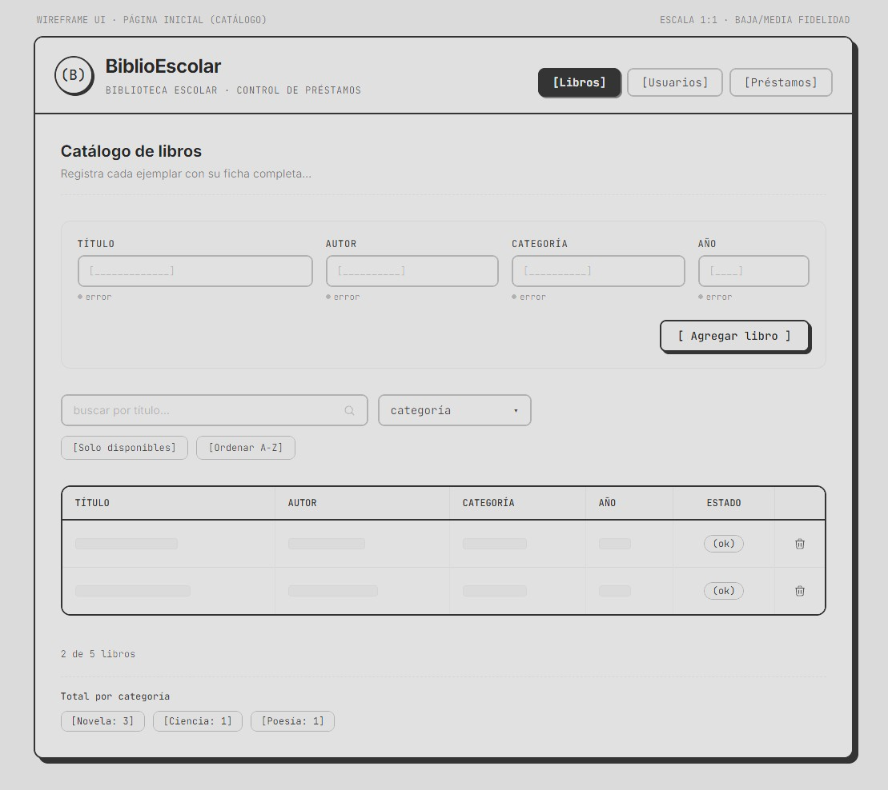

# BiblioEscolar

Control de préstamos de una biblioteca escolar. Proyecto final de ADSO.

## Equipo

- Mateo Porras Jiménez · [@mateoporras](https://github.com/mateoporras)
- Andrés Callejas Jiménez · [@ProbablyWasted](https://github.com/ProbablyWasted)
- Dayana Marulanda · [@dmarulandaecheverry-ship-it](https://github.com/dmarulandaecheverry-ship-it)

## El problema

En una biblioteca escolar el control de ejemplares, estudiantes y préstamos se lleva casi siempre en papel o en una hoja de cálculo desordenada. Así es difícil saber qué libros están disponibles, quién tiene un ejemplar prestado y a quién se le venció la entrega.

BiblioEscolar resuelve eso con una sola pantalla donde el encargado registra los libros, registra a los lectores, presta un ejemplar con fecha límite y marca la devolución. Todo queda guardado en el navegador, así que al recargar la página la información sigue ahí.

## Funcionalidades

1. **Catálogo de libros.** Se registran ejemplares con título, autor, categoría, año y estado de disponibilidad.
2. **Usuarios.** Se dan de alta estudiantes o docentes con nombre, documento y grado.
3. **Préstamos y devoluciones.** Se asocia un libro disponible con un usuario y una fecha límite. Al devolverlo, el libro vuelve a estar disponible.
4. **Búsqueda en vivo.** El catálogo se filtra mientras se escribe, por título o por autor.
5. **Filtros y orden.** Se puede filtrar por categoría, mostrar solo los disponibles y ordenar alfabéticamente.
6. **Vencidos.** Se puede consultar qué préstamos siguen abiertos y ya pasaron la fecha límite.
7. **Totales por categoría.** Al lado del catálogo se muestra cuántos libros hay de cada categoría.

## Cómo se organiza el proyecto

```
index.html          Las tres pantallas y los formularios
css/styles.css      Estilos
js/datos.js         Arreglos globales, claves y guardado en localStorage
js/filtros.js       Búsqueda, filtros, orden y totales
js/formulario.js    Validación de los formularios
js/app.js           Render de las tablas y eventos
boceto.jpg          Dibujo de la interfaz
```

Los scripts se cargan en este orden: `datos.js`, `filtros.js`, `formulario.js`, `app.js`. Si se cambia el orden, `app.js` intenta usar los arreglos antes de que existan y la página queda en blanco.

No hay servidor ni base de datos. La app corre completamente en el navegador.

## Cómo probarlo

1. Descargar o clonar el repositorio.
2. Abrir `index.html` con doble clic en el navegador.
3. Agregar un libro desde el formulario y recargar la página: el libro debe seguir ahí.
4. Abrir la consola con F12. No deben aparecer errores.

La versión publicada se abre desde el enlace de GitHub Pages de la configuración del repositorio.

## Datos que se guardan en localStorage

- **Libros:** `id`, `titulo`, `autor`, `categoria`, `anio`, `disponible`. Se guardan bajo la clave `biblio-libros`.
- **Usuarios:** `id`, `nombre`, `documento`, `grado`. Se guardan bajo la clave `biblio-usuarios`.
- **Préstamos:** `id`, `libroId`, `usuarioId`, `fechaPrestamo`, `fechaDevolucion`, `devuelto`. Se guardan bajo la clave `biblio-prestamos`.

Los préstamos guardan ids y no nombres. El título del libro y el nombre del usuario se buscan con `find` al momento de pintar la tabla, para que un cambio en el catálogo se refleje en todas partes.

Las categorías son fijas: Novela, Cuento, Poesía, Ciencia, Historia, Infantil y Texto escolar.

## Búsqueda, filtro u orden

- **Buscar (`filter`):** se recorre el catálogo comparando título y autor en minúsculas con `includes`, para que no importe cómo se escriba.
- **Filtrar por categoría (`filter`):** se quedan solo los libros de la categoría elegida en el selector.
- **Filtrar disponibles (`filter`):** se muestran únicamente los ejemplares con `disponible === true`.
- **Ordenar (`sort`):** se ordena una copia del arreglo con `slice` y `localeCompare`. El arreglo original no se modifica.
- **Totales (`reduce`):** se cuenta cuántos libros hay de cada categoría con `reduce` sobre el catálogo completo, no sobre lo que esté filtrado.
- **Buscar por id (`find`):** se usa al registrar una devolución, para encontrar el préstamo y el libro correspondientes.
- **Vencidos (`filter`):** se filtran los préstamos con `devuelto === false` cuya `fechaDevolucion` ya pasó.

## Boceto



## Reparto de tareas

| Integrante | Archivos | Qué hizo |
|---|---|---|
| Mateo Porras Jiménez | `index.html`, `css/styles.css`, `js/app.js` | Estructura de las tres pantallas, estilos y render del catálogo con sus eventos |
| Andrés Callejas Jiménez | `js/formulario.js` | Validación campo por campo de los formularios y registro de libros |
| Dayana Marulanda | `js/datos.js`, `js/filtros.js` | Guardado en localStorage y funciones de búsqueda, filtro, orden y totales |

## Estado del proyecto

La primera entrega deja funcionando el módulo de libros: registro validado, tabla pintada desde los datos, búsqueda, filtros, orden, totales y persistencia al recargar. Las pantallas de usuarios y préstamos ya están en la estructura y se completan en la segunda entrega.
